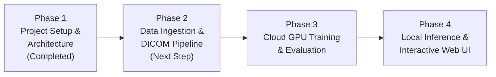

# Automated Medical Image Analysis for Early Disease Detection

[](https://www.python.org/downloads/)
[](https://github.com/ultralytics/ultralytics)
[](https://www.kaggle.com/c/rsna-pneumonia-detection-challenge)
[-purple.svg)](#hardware-architecture)

An end-to-end computer vision and deep learning system for automated chest radiograph (X-ray) analysis. The system detects the presence of pneumonia and localizes suspected lung opacities using bounding boxes with associated confidence metrics.

---

## 🎯 Clinical & Technical Goals

1. **DICOM Ingestion**: Read native 16-bit medical radiographs (`.dcm`), apply Value of Interest (VOI) LUT / windowing, and invert photometric interpretation (`MONOCHROME1` to `MONOCHROME2`) so anatomical structures and opacities are clearly visible.
2. **Binary Classification & Localization**: Predict whether pneumonia is present (`Target=1`) or normal/non-pneumonia (`Target=0`), while drawing bounding boxes around pathological lung opacities.
3. **Clinical Presentation**: Display original radiograph alongside predicted bounding boxes, class labels (`Lung Opacity`), and detection confidence scores.
4. **Interactive Clinician Interface**: Provide a lightweight local web interface (Gradio) for drag-and-drop inference on new chest X-rays.

---

## 💻 Hardware Architecture & Strategy

- **Local Machine**: Apple MacBook M1 (8 GB Unified Memory).
  - Used for code authoring, unit testing, local inference (`device="mps"` or `cpu`), and running the interactive web application.
  - Memory-efficient: Keeps model weights lightweight (`yolov8s` / `yolov8n`), avoiding memory pressure on 8 GB RAM.
- **Cloud Training**: Kaggle Notebooks or Google Colab (NVIDIA T4 / P100 GPU).
  - The RSNA dataset contains ~30,000 full-resolution DICOM images (~3.5 GB compressed, ~20+ GB uncompressed).
  - Heavy multi-epoch YOLO training is executed in the cloud GPU environment using [`notebooks/01_rsna_yolo_cloud_training.ipynb`](notebooks/01_rsna_yolo_cloud_training.ipynb).
  - Trained weights (`best.pt`) are downloaded back into `models/weights/` for local deployment.

---

## 🗺️ 4-Phase Implementation Roadmap



### ✅ Phase 1: Environment & Project Scaffolding (Current)
- [x] Clean, modular project structure (`src/`, `notebooks/`, `tests/`, `data/`, `models/`).
- [x] Environment configuration (`requirements.txt`, `.gitignore`).
- [x] Cloud GPU training notebook skeleton (`notebooks/01_rsna_yolo_cloud_training.ipynb`).
- [x] Core modular components:
  - `src/config.py`: Path definitions and hardware accelerator detection (Apple M1 MPS vs CUDA vs CPU).
  - `src/data/dicom_utils.py`: VOI LUT, windowing, and DICOM header metadata extraction.
  - `src/data/rsna_parser.py`: RSNA CSV annotation parsing and normalized YOLO coordinate conversion.
  - `src/models/detector.py`: YOLOv8 wrapper with lazy loading and fallback handling.
  - `src/visualization/visualizer.py`: Bounding box annotation overlays and side-by-side comparisons.
  - `src/inference/pipeline.py`: Unified DICOM-to-diagnosis pipeline.
- [x] Automated unit test suite (`tests/test_config.py`, `tests/test_coordinates.py`, `tests/test_visualizer.py`).

### 🔜 Phase 2: Data Pipeline & DICOM Conversion (Next Step)
- [ ] Acquire RSNA dataset sample or full dataset via Kaggle API.
- [ ] Verify DICOM windowing on real RSNA chest radiographs.
- [ ] Parse `stage_2_train_labels.csv` and generate YOLO-formatted text annotations (`<class> <x_center> <y_center> <width> <height>`).
- [ ] Create stratified train/val split (80/20) by patient ID (preventing patient leakage).
- [ ] Generate `dataset.yaml` for YOLO training.
- [ ] Build a verification test with a real RSNA chest X-ray, ground-truth label, and annotated bounding boxes.

### ⏳ Phase 3: Cloud GPU Training & Evaluation
- [ ] Launch `notebooks/01_rsna_yolo_cloud_training.ipynb` on Kaggle or Colab with GPU T4.
- [ ] Train YOLOv8 model for 25 epochs with transfer learning.
- [ ] Evaluate Mean Average Precision (`mAP50`, `mAP50-95`), Precision, Recall, and IoU metrics.
- [ ] Download fine-tuned model checkpoint (`best.pt`) to `models/weights/best.pt`.

### ⏳ Phase 4: Local Inference, Visualizer & Web Application
- [ ] Benchmark local inference latency on Apple M1 Mac using PyTorch MPS acceleration.
- [ ] Build interactive web application using Gradio (`app.py`).
- [ ] Allow clinicians to upload `.dcm`, `.png`, or `.jpg` chest radiographs.
- [ ] Display side-by-side diagnostic views, bounding box coordinates, and opacity probability metrics.

---

## 📁 Repository Structure

```text
Disease_Detection_Iva/
├── .gitignore                      # Excludes large datasets, model weights, checkpoints
├── README.md                       # Project documentation and roadmap
├── requirements.txt                # Python package dependencies
├── data/
│   ├── raw/                        # Raw RSNA dataset (.dcm files, stage_2_train_labels.csv)
│   ├── processed/                  # YOLO-ready dataset (images/ and labels/ splits)
│   └── samples/                    # Sample X-rays for testing and demonstration
├── models/
│   └── weights/                    # Saved model weights (best.pt)
├── notebooks/
│   ├── README.md                   # Cloud notebook execution instructions
│   └── 01_rsna_yolo_cloud_training.ipynb  # Kaggle/Colab training pipeline
├── src/
│   ├── __init__.py
│   ├── config.py                   # Centralized paths, image constants, device detection
│   ├── data/
│   │   ├── __init__.py
│   │   ├── dicom_utils.py          # DICOM reading, VOI LUT, MONOCHROME inversion
│   │   └── rsna_parser.py          # Coordinate transformations and label parsing
│   ├── models/
│   │   ├── __init__.py
│   │   └── detector.py             # YOLOv8 pneumonia detector wrapper
│   ├── visualization/
│   │   ├── __init__.py
│   │   └── visualizer.py           # High-contrast bounding box overlays & side-by-side views
│   └── inference/
│       ├── __init__.py
│       └── pipeline.py             # End-to-end diagnostic pipeline
└── tests/
    ├── __init__.py
    ├── test_config.py              # Configuration and path validation tests
    ├── test_coordinates.py         # RSNA to YOLO coordinate conversion tests
    └── test_visualizer.py          # Overlay and image concatenation tests
```

---

## 🚀 Development Environment Setup

### 1. Prerequisites
- macOS on Apple Silicon (M1 / M2 / M3) or Linux.
- Python 3.10 installed (`python3 --version`).

### 2. Create Virtual Environment
In the project directory:

```bash
# Create a virtual environment named .venv
python3 -m venv .venv

# Activate the virtual environment
source .venv/bin/activate
```

### 3. Install Dependencies
```bash
pip install --upgrade pip
pip install -r requirements.txt
```

### 4. Run Verification Tests
```bash
pytest tests/ -v
```

---

## 🔑 Kaggle Dataset Authentication (For Phase 2 & 3)

To download or access the RSNA dataset:
1. Create a free account at [kaggle.com](https://www.kaggle.com).
2. Go to **Account Settings -> API -> Create New Token**. This downloads `kaggle.json`.
3. Place `kaggle.json` at `~/.kaggle/kaggle.json` on your Mac:
   ```bash
   mkdir -p ~/.kaggle
   mv /path/to/downloaded/kaggle.json ~/.kaggle/
   chmod 600 ~/.kaggle/kaggle.json
   ```
4. Accept competition rules on the [RSNA Pneumonia Detection Challenge](https://www.kaggle.com/c/rsna-pneumonia-detection-challenge/rules) page.
